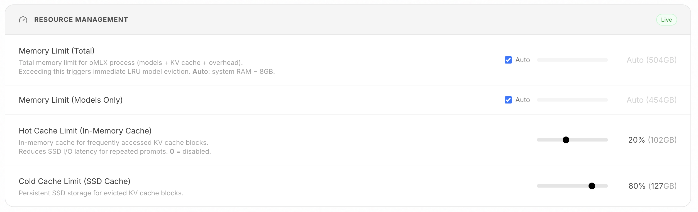
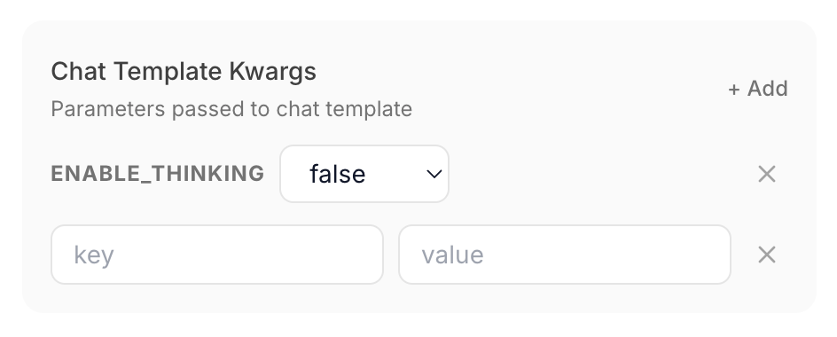
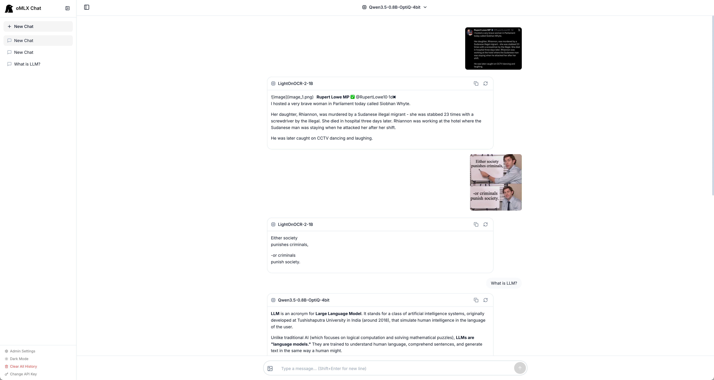
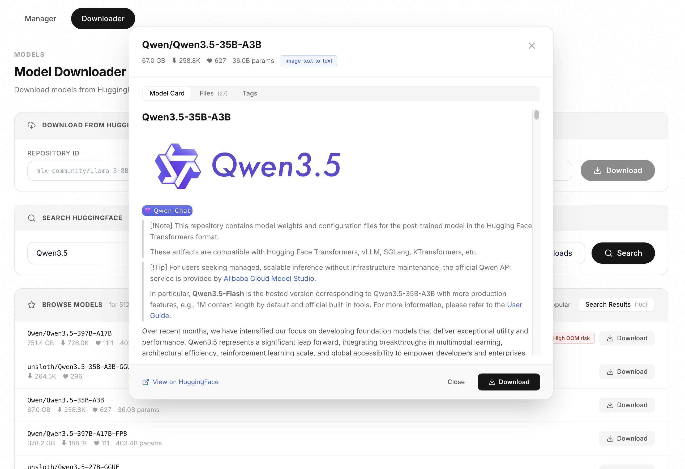
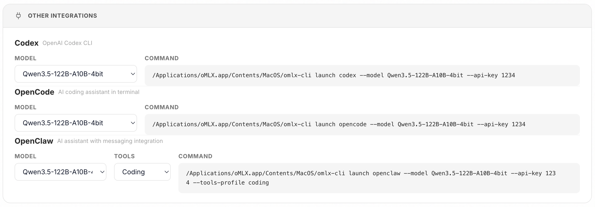
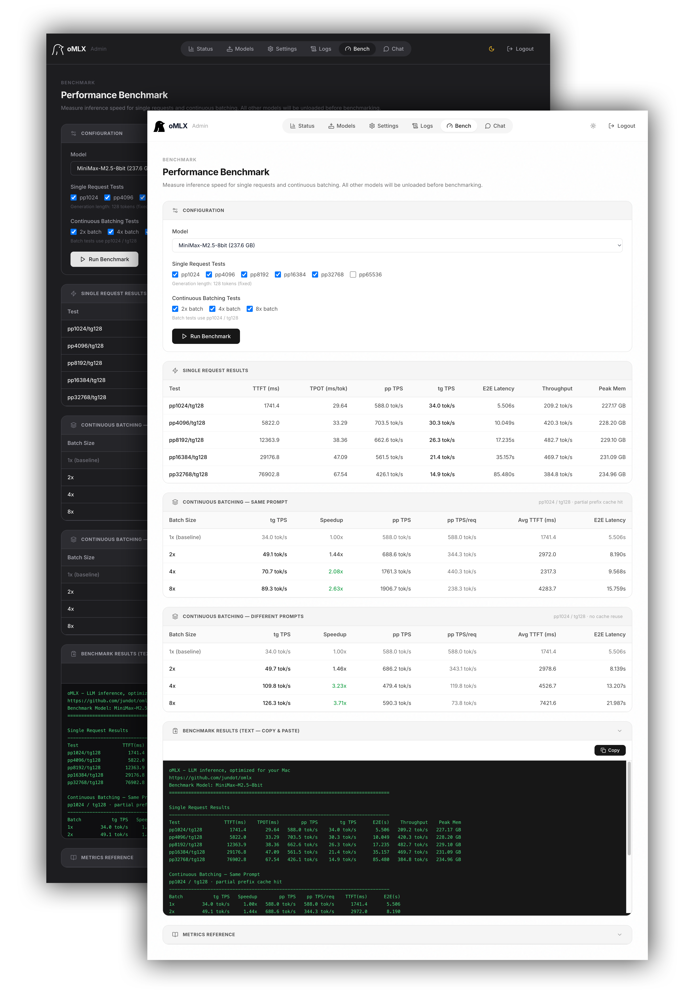

<p align="center">
  <picture>
    <source media="(prefers-color-scheme: dark)" srcset="docs/images/icon-rounded-dark.svg" width="140">
    <source media="(prefers-color-scheme: light)" srcset="docs/images/icon-rounded-light.svg" width="140">
    
  </picture>
</p>

<h1 align="center">oMLX</h1>
<p align="center"><b>Inferenza LLM, ottimizzata per il tuo Mac</b><br>Batching continuo e cache KV a livelli, gestiti direttamente dalla barra dei menu.</p>

<p align="center">
  
  
  
</p>

<p align="center">
  <a href="mailto:junkim.dot@gmail.com">junkim.dot@gmail.com</a> · <a href="https://omlx.ai/me">https://omlx.ai/me</a>
</p>

<p align="center">
  <a href="#installazione">Installazione</a> ·
  <a href="#avvio-rapido">Avvio rapido</a> ·
  <a href="#funzionalità">Funzionalità</a> ·
  <a href="#modelli">Modelli</a> ·
  <a href="#configurazione-da-cli">Configurazione da CLI</a> ·
  <a href="https://omlx.ai/benchmarks">Benchmark</a> ·
  <a href="https://omlx.ai">oMLX.ai</a>
</p>

<p align="center">
  <a href="README.md">English</a> ·
  <a href="README.zh.md">中文</a> ·
  <a href="README.ko.md">한국어</a> ·
  <a href="README.ja.md">日本語</a> ·
  <a href="README.fr.md">Français</a> ·
  <b>Italiano</b>
</p>

---

<p align="center">
  
</p>

> *Ogni server LLM che ho provato mi costringeva a scegliere tra comodità e controllo. Volevo fissare in memoria i modelli di tutti i giorni, far subentrare su richiesta quelli più pesanti, impostare limiti di contesto - e gestire tutto dalla barra dei menu.*
>
> *oMLX rende persistente la cache KV su un livello hot in memoria e un livello cold su SSD: anche quando il contesto cambia a metà conversazione, tutto il contesto precedente resta in cache ed è riutilizzabile da una richiesta all'altra, il che rende gli LLM locali adatti al vero lavoro di programmazione con strumenti come Claude Code. Per questo l'ho creato.*

## Installazione

### App macOS

Scarica il file `.dmg` da [Releases](https://github.com/jundot/omlx/releases), trascina l'app in Applicazioni e il gioco è fatto. L'app integra l'aggiornamento automatico, quindi per le versioni successive basta un clic. L'app macOS installa anche `~/.omlx/bin/omlx`, un leggero shim della CLI che permette ai comandi da terminale e a Comandi Rapidi di Apple di controllare il server gestito dall'app.

### Homebrew

```bash
brew tap jundot/omlx https://github.com/jundot/omlx
brew install jundot/omlx/omlx --with-custom-kernel   # Con i kernel personalizzati nativi (richiede Xcode completo)
# Senza Xcode completo? brew install jundot/omlx/omlx installa senza i kernel

# Aggiorna all'ultima versione
brew update && brew upgrade omlx

# Esegui come servizio in background (si riavvia automaticamente in caso di crash)
omlx start

# Facoltativo: supporto MCP (Model Context Protocol)
/opt/homebrew/opt/omlx/libexec/bin/pip install mcp
```

### Dai sorgenti

```bash
git clone https://github.com/jundot/omlx.git
cd omlx
make install                # Installazione in modalità editable con l'interfaccia web e i kernel personalizzati nativi
# Senza Xcode completo? make install-no-kernels installa senza i kernel
make mcp                    # Facoltativo: supporto MCP (Model Context Protocol)
```

Richiede macOS 15.0+ (Sequoia), Python 3.11–3.13 e Apple Silicon (M1/M2/M3/M4/M5).

> **Nota sui kernel personalizzati nativi:** GLM-5.2, MiniMax M3 e Qwen3.5 ne hanno bisogno.
> Senza di essi queste famiglie ripiegano, senza alcun avviso, su percorsi generici molto più lenti:
> per GLM-5.2 il prefill DSA fuso è circa 30 volte più veloce con i kernel
> (845 contro ~29 tok/s misurati su un M3 Ultra), e il fallback consuma anche più
> memoria (#2137). `make install` li compila e verifica che ciascuno venga caricato. Per farlo
> serve Xcode completo con la toolchain Metal (`xcodebuild -downloadComponent
> MetalToolchain`); i soli Command Line Tools non la includono (`xcrun: error:
> unable to find utility "metal"`). Senza Xcode, usa il DMG ufficiale, che
> contiene i kernel precompilati, oppure `make install-no-kernels`. Anche un semplice
> `pip install -e .` li salta. `make kernels` ricompila da zero i soli
> kernel. Homebrew li compila con `--with-custom-kernel`, che richiede anch'esso
> Xcode completo. Per verificare qualsiasi installazione:
>
> ```bash
> python -c "from omlx.custom_kernels import native_kernel_status; print(native_kernel_status())"
> ```

## Avvio rapido

### App macOS

Avvia oMLX dalla cartella Applicazioni. La schermata di benvenuto ti guida in tre passaggi: directory dei modelli, avvio del server e download del primo modello. Tutto qui. Per collegare OpenClaw, OpenCode, Codex, Hermes Agent, Copilot o DeepSeek Harness, vedi [Integrazioni](#integrazioni).

<p align="center">
  
  
</p>

### CLI

```bash
# Server gestito in background (app macOS o installazione Homebrew)
omlx start
omlx stop
omlx restart

# Server in primo piano, collegato a questo terminale
omlx serve --model-dir ~/models
```

Il server rileva automaticamente LLM, VLM, modelli di embedding e reranker nelle sottodirectory. Qualsiasi client compatibile con OpenAI può connettersi a `http://localhost:8000/v1`. È disponibile anche un'interfaccia di chat integrata all'indirizzo `http://localhost:8000/admin/chat`.

### Servizio Homebrew

Se hai installato oMLX con Homebrew, puoi eseguirlo come servizio gestito in background:

```bash
omlx start                    # Avvia tramite brew services
omlx stop                     # Arresta
omlx restart                  # Riavvia

brew services start omlx    # Avvia (si riavvia automaticamente in caso di crash)
brew services stop omlx     # Arresta
brew services restart omlx  # Riavvia
brew services info omlx     # Controlla lo stato
```

Il servizio esegue `omlx serve` con valori predefiniti che non richiedono alcuna configurazione (`~/.omlx/models`, porta 8000). `omlx start`, `omlx stop` e `omlx restart` sono i comandi portabili per il ciclo di vita del server; nelle installazioni Homebrew vengono delegati a `brew services`. Per personalizzare la configurazione, imposta le variabili d'ambiente (`OMLX_MODEL_DIR`, `OMLX_PORT` ecc.) oppure esegui una volta `omlx serve --model-dir /your/path` per salvare le impostazioni in `~/.omlx/settings.json`.

I log vengono scritti in due posizioni:
- **Log del servizio**: `$(brew --prefix)/var/log/omlx.log` (stdout/stderr)
- **Log del server**: `~/.omlx/logs/server.log` (log applicativo strutturato)

## Funzionalità

Supporta LLM testuali, modelli visione-linguaggio (VLM), modelli OCR, embedding e reranker su Apple Silicon.

### Dashboard di amministrazione

Interfaccia web all'indirizzo `/admin` per monitoraggio in tempo reale, gestione dei modelli, chat, benchmark e impostazioni per modello. Supporta inglese, coreano, giapponese, cinese, francese, russo, spagnolo e portoghese brasiliano. Tutte le dipendenze CDN sono incluse nel pacchetto, così tutto funziona anche completamente offline.

<p align="center">
  
</p>

### Inferenza sperimentale su più Mac

Le build da sorgente possono suddividere un modello linguistico scaricato tra Mac con
quantità di memoria diverse, usando i rank della pipeline MLX su Ring oppure su RDMA/JACCL via
Thunderbolt. La dashboard Cluster si occupa del rilevamento dei peer in sola lettura, della
verifica rigorosa di SSH e runtime, della pianificazione di shard disuguali in base ai byte,
del ribilanciamento in base alle misure di calcolo e di collegamento, della regolazione
dell'esecuzione in funzione del margine di memoria, dell'attivazione e di una mappa in tempo
reale di shard e prestazioni su entrambi i Mac. I profili interattivo, bilanciato e throughput
espongono il batching accorpato, l'affinità della cache dei prompt, i limiti della cache KV a
rotazione, la regolazione delle connessioni Ring e un percorso di output sperimentale di soli
token, disponibile solo dove supportato. Vedi
[Distributed inference across Macs](docs/experimental/distributed-cluster.md) per la configurazione,
i confini di sicurezza, le limitazioni attuali e la checklist di validazione su hardware
fisico.

### Modelli visione-linguaggio

Esegui i VLM con lo stesso stack di batching continuo e cache KV a livelli degli LLM testuali. Supporta chat con più immagini, immagini in ingresso come base64, URL o file, e tool calling con contesto visivo. I checkpoint MiMo V2.6 con sidecar inclusi accettano anche video a fotogrammi campionati e audio a 24 kHz. I checkpoint Qwen3.5, Qwen3.6 e Qwen3.8 (densi e MoE) accettano video in ingresso nativo come data URI base64 `video_url` / `input_video`; per il video serve OpenCV (`opencv-python-headless`). La conversione oQ dei checkpoint MiMo V2.6 ufficiali conserva il supporto per immagini e audio. I modelli OCR (DeepSeek-OCR, DOTS-OCR, GLM-OCR) vengono rilevati automaticamente e usati con prompt ottimizzati.

### Cache KV a livelli (hot + cold)

Gestione della cache KV a blocchi ispirata a vLLM, con condivisione dei prefissi e Copy-on-Write. La cache opera su due livelli:

- **Livello hot (RAM)**: i blocchi usati di frequente restano in memoria per un accesso rapido.
- **Livello cold (SSD)**: quando la cache hot si riempie, i blocchi vengono trasferiti su SSD in formato safetensors. Alla richiesta successiva con un prefisso corrispondente vengono ripristinati dal disco invece di essere ricalcolati da zero, anche dopo un riavvio del server.

<p align="center">
  
</p>

### Batching continuo

Gestisce le richieste simultanee tramite il BatchGenerator di mlx-lm. Il numero massimo di richieste simultanee è configurabile dalla CLI o dal pannello di amministrazione.

### Ottimizzazione per Claude Code

Permette di usare con Claude Code modelli con un contesto più ridotto: oMLX comunica la finestra di contesto reale del modello, così la compattazione automatica scatta al momento giusto senza dover riscalare i conteggi dei token, mentre il keep-alive SSE evita i timeout di lettura durante i prefill lunghi.

### Servizio multi-modello

Carica LLM, VLM, modelli di embedding e reranker nello stesso server. I modelli vengono gestiti con una combinazione di controlli automatici e manuali:

- **Espulsione LRU**: quando la memoria scarseggia, i modelli usati meno di recente vengono espulsi automaticamente.
- **Caricamento/rilascio manuale**: i badge di stato interattivi nel pannello di amministrazione permettono di caricare o rilasciare i modelli su richiesta.
- **Modelli fissati**: fissa i modelli che usi più spesso per tenerli sempre caricati.
- **TTL per modello**: imposta per ogni modello un timeout di inattività, trascorso il quale viene rilasciato automaticamente.
- **Limite di memoria del processo**: un limite di memoria totale (predefinito: RAM di sistema - 8GB) evita che l'intero sistema esaurisca la memoria (OOM).

### Impostazioni per modello

Configura parametri di campionamento, kwargs del chat template, TTL, alias del modello, forzatura del tipo di modello e altro ancora, per ciascun modello, direttamente dal pannello di amministrazione. Le modifiche si applicano subito, senza riavviare il server.

- **Alias del modello**: imposta un nome personalizzato visibile tramite l'API. `/v1/models` restituisce l'alias e le richieste accettano sia l'alias sia il nome della directory.
- **Forzatura del tipo di modello**: imposta manualmente un modello come LLM o VLM, indipendentemente dal rilevamento automatico.
- **Motore esterno**: servi i checkpoint MLX di Qwen3.8-27B e Qwen3.6-35B-A3B presenti nelle tue directory dei modelli con il motore Metal di [Splash](https://github.com/incoai/splash), in un processo separato (build ufficiale su M3 o successivi, Splash M1 su M1/M2). Vedi [docs/Splash.md](docs/Splash.md).
- **Profili**: salva con un nome gruppi di impostazioni per modello e passa dall'uno all'altro dal pannello di amministrazione. Un profilo può anche essere esposto come modello a sé: in tal caso `/v1/models` elenca anche `<model>:<profile>` (es. `qwen3-8b:thinking`), servito dallo stesso motore del modello base con le impostazioni del profilo applicate a ogni richiesta — senza memoria aggiuntiva e senza ricaricare il modello. Se il modello base ha un alias, l'ID esposto viene pubblicato come `<alias>:<profile>`; la forma con il nome della directory continua a funzionare, proprio come per il modello base.

<p align="center">
  
</p>

### Chat integrata

Chatta con qualsiasi modello caricato direttamente dal pannello di amministrazione. Supporta cronologia delle conversazioni, cambio di modello, tema scuro, output dei modelli con ragionamento e caricamento di immagini per i modelli VLM/OCR.

<p align="center">
  
</p>


### Download dei modelli

Cerca e scarica modelli MLX da HuggingFace direttamente dalla dashboard di amministrazione. Sfoglia le schede dei modelli, controlla le dimensioni dei file e scarica con un clic.

<p align="center">
  
</p>

### Integrazioni

Configura OpenClaw, OpenCode, Codex, Hermes Agent, Copilot, Pi, Mistral Vibe e DeepSeek Harness con un solo clic, direttamente dalla dashboard di amministrazione. Non serve modificare a mano alcun file di configurazione.

<p align="center">
  
</p>

Installa [Mistral Vibe](https://github.com/mistralai/mistral-vibe) 2.26.0 o successivo con `uv tool install mistral-vibe`, poi esegui `omlx launch vibe` per scegliere un modello locale, oppure `omlx launch vibe --model <model-id>`. Provider, modello, riferimento alla chiave API e finestra di contesto di Vibe vengono configurati per quel processo tramite le variabili d'ambiente `VIBE_*`, che ne sovrascrivono la configurazione. Il file `config.toml` esistente, `VIBE_HOME`, i permessi dei tool e la configurazione cloud restano invariati. Gli argomenti per Vibe vanno passati dopo `--`, ad esempio `omlx launch vibe --model <model-id> -- --resume`.

### Benchmark delle prestazioni

Benchmark con un clic dal pannello di amministrazione. Misura i token al secondo in prefill (PP) e in generazione del testo (TG), con test di riuso parziale della cache dei prefissi per ottenere numeri realistici.

<p align="center">
  
</p>

### App per la barra dei menu di macOS

App nativa per la barra dei menu in Swift / SwiftUI (non Electron). Avvia, arresta e monitora il server senza aprire un terminale. Include una [cronologia di utilizzo locale](docs/usage-analytics.md) con totali per modello e una heatmap oraria, statistiche di servizio persistenti (sopravvivono ai riavvii), riavvio automatico in caso di crash e aggiornamento automatico integrato.

<p align="center">
  
</p>

### Compatibilità API

Sostituisce le API di OpenAI e Anthropic senza modifiche lato client. Supporta le statistiche di utilizzo in streaming (`stream_options.include_usage`), l'avanzamento del prefill in stile llama.cpp (`return_progress`), l'adaptive thinking di Anthropic e gli input visivi (immagini in base64 o tramite URL, video in base64).

| Endpoint | Descrizione |
|----------|-------------|
| `POST /v1/chat/completions` | Chat completions (streaming) |
| `POST /v1/completions` | Completamento di testo (streaming) |
| `POST /v1/messages` | API Messages di Anthropic |
| `POST /v1/embeddings` | Embedding di testo |
| `POST /v1/rerank` | Reranking di documenti |
| `POST /v1/systemone` | Decisioni tipizzate con modelli decisionali (TypeSafe System One) |
| `GET /v1/models` | Elenco dei modelli disponibili |
| `POST /tokenize`, `POST /detokenize` | API del tokenizer compatibile con vLLM (anche sotto `/v1`) |

L'API di amministrazione per impostazioni, modelli, download, quantizzazione e benchmark accetta la chiave API principale come token Bearer e funziona anche in modalità headless. Vedi [Admin API](docs/admin-api.md).

### Tool calling e output strutturato

Supporta tutti i formati di function calling disponibili in mlx-lm, la validazione con JSON Schema e l'integrazione dei tool MCP. Il tool calling richiede che il chat template del modello supporti il parametro `tools`. Le seguenti famiglie di modelli vengono rilevate automaticamente:

| Famiglia di modelli | Formato |
|---|---|
| Llama, Qwen, DeepSeek ecc. | JSON `<tool_call>` |
| Serie Qwen3.5 | XML `<function=...>` |
| Gemma | `<start_function_call>` |
| GLM (4.7, 5) | XML `<arg_key>/<arg_value>` |
| MiniMax | `<minimax:tool_call>` con namespace |
| Mistral | `[TOOL_CALLS]` |
| IFM K2 Horizon | XML o JSON all'interno di `<ifm\|tool_calls>`. Richiede `omlx[grammar]` |
| Kimi K2 | `<\|tool_calls_section_begin\|>` |
| Longcat | `<longcat_tool_call>` |

I modelli non elencati qui sopra possono funzionare comunque, se il loro chat template accetta `tools` e il loro output usa un formato XML `<tool_call>` riconosciuto. Nello streaming con i tool attivi, il testo dell'assistente viene emesso in modo incrementale, mentre il markup di controllo noto delle chiamate ai tool viene escluso dal contenuto visibile; le chiamate ai tool strutturate vengono emesse dopo il parsing del turno completo.

Una grammatica JSON, EBNF o regex usata da sola vincola la risposta fin dal primo token generato, quindi `thinking_budget` viene ignorato. Per combinare l'output vincolato con una fase di ragionamento separata e soggetta a budget, configura un `reasoning_parser` compatibile.

## Modelli

Fai puntare `--model-dir` a una directory che contiene sottodirectory di modelli in formato MLX. Sono supportate anche le cartelle organizzate su due livelli (es. `mlx-community/model-name/`).

```
~/models/
├── Step-3.5-Flash-8bit/
├── Qwen3-Coder-Next-8bit/
├── gpt-oss-120b-MXFP4-Q8/
├── Qwen3.5-122B-A10B-4bit/
└── bge-m3/
```

Il tipo di ogni modello viene rilevato automaticamente. Puoi anche scaricare i modelli direttamente dalla dashboard di amministrazione.

| Tipo | Modelli |
|------|--------|
| LLM | Qualsiasi modello supportato da [mlx-lm](https://github.com/ml-explore/mlx-lm) |
| VLM | Serie Qwen3.5, GLM-4V, Pixtral e altri modelli [mlx-vlm](https://github.com/Blaizzy/mlx-vlm) |
| OCR | DeepSeek-OCR, DOTS-OCR, GLM-OCR |
| Embedding | BERT, BGE-M3, ModernBERT, EmbeddingGemma 2 |
| Reranker | ModernBERT, XLM-RoBERTa |
| Decisionale | Clef, Clef-Flash, OpenJev, Decision 3.0 (d3, d3-flash, d3-mini, d3-nano, d3-lite, d3-edge) |

## Configurazione da CLI

```bash
# Server gestito in background (app macOS o installazione Homebrew)
omlx start
omlx stop
omlx restart

# Avvia con le impostazioni predefinite (livello di protezione della memoria = balanced, gestibile dall'interfaccia di amministrazione)
omlx serve --model-dir ~/models

# Scegli un livello di protezione della memoria all'avvio
omlx serve --model-dir ~/models --memory-guard safe

# Imposta un tetto personalizzato in GB per la protezione della memoria
omlx serve --model-dir ~/models --memory-guard-gb 48

# Attiva la cache SSD per i blocchi KV
omlx serve --model-dir ~/models --paged-ssd-cache-dir ~/.omlx/cache

# Imposta la dimensione della cache hot in memoria
omlx serve --model-dir ~/models --hot-cache-max-size 20%

# Regola il numero massimo di richieste simultanee (predefinito: 8)
omlx serve --model-dir ~/models --max-concurrent-requests 16

# Con i tool MCP
omlx serve --model-dir ~/models --mcp-config mcp.json

# Endpoint mirror di HuggingFace (per le regioni con accesso limitato)
omlx serve --model-dir ~/models --hf-endpoint https://hf-mirror.com

# Autenticazione con chiave API
omlx serve --model-dir ~/models --api-key your-secret-key
# Solo localhost: la verifica si può saltare dalle impostazioni globali del pannello di amministrazione

# L'accesso dalla rete richiede l'autenticazione
OMLX_API_KEY=your-secret-key omlx serve --model-dir ~/models --host 0.0.0.0

# Solo API di inferenza e di amministrazione, senza l'interfaccia web (non viene salvato nelle impostazioni)
omlx serve --model-dir ~/models --headless
```

Il limite predefinito della cache SSD, `auto`, usa il 50% della somma tra lo spazio libero su disco e i file della cache SSD già esistenti, sidecar GDN compresi. Il budget viene ricalcolato durante l'uso e non si riduce per il solo fatto che la cache cresce o che il server viene riavviato. Può invece cambiare se varia lo spazio occupato da altri dati sul disco. Per un limite fisso, imposta `--paged-ssd-cache-max-size 20GB`.


La maggior parte delle impostazioni si può configurare anche dal pannello di amministrazione web all'indirizzo `/admin`. Le impostazioni vengono salvate in `~/.omlx/settings.json` e i flag della CLI hanno la precedenza.
Imposta la chiave API principale prima di cambiare l'host del server in un indirizzo LAN o in `0.0.0.0`, oppure salva le due impostazioni insieme. Senza una chiave API principale, oMLX si rifiuta di avviarsi su qualsiasi indirizzo che non sia di loopback. L'opzione esistente `skip_api_key_verification` resta limitata ai bind sul solo loopback.

Per l'inferenza senza chiave, arresta oMLX, imposta manualmente `auth.allow_unauthenticated_inference` su `true` in `settings.json` e riavvia. Il valore predefinito è `false` e non esiste un'opzione corrispondente nell'interfaccia. In questo modo chiunque riesca a raggiungere il server può usare l'inferenza (comprese le Responses memorizzate e l'audio), i tool MCP e la ricerca web. Sui bind di rete, mantieni configurata una chiave API principale e lascia `skip_api_key_verification` su `false`; gli endpoint di gestione continuano a richiedere l'autenticazione.

<details>
<summary>Architettura</summary>

```
Server FastAPI (API OpenAI / Anthropic)
    │
    ├── EnginePool (multi-modello, espulsione LRU, TTL, caricamento/rilascio manuale)
    │   ├── BatchedEngine (LLM, batching continuo)
    │   ├── VLMEngine (modelli visione-linguaggio)
    │   ├── EmbeddingEngine
    │   ├── RerankerEngine
    │   └── DecisionEngine
    │
    ├── ProcessMemoryEnforcer (limite di memoria totale, controlli TTL)
    │
    ├── Scheduler (FCFS, concorrenza configurabile)
    │   └── mlx-lm BatchGenerator
    │
    └── Stack della cache
        ├── PagedCacheManager (GPU, a blocchi, CoW, condivisione dei prefissi)
        ├── Hot Cache (livello in memoria, write-back)
        └── PagedSSDCacheManager (livello cold su SSD, formato safetensors)
```

</details>

## Sviluppo

### Comandi di build

| Comando | Che cosa fa |
|---|---|
| `make install` | Installazione in modalità editable del server e dell'interfaccia web, seguita dai kernel personalizzati nativi |
| `make install-no-kernels` | Come sopra ma senza i kernel, per le macchine senza Xcode completo |
| `make mcp` | Aggiunge il supporto MCP (Model Context Protocol) |
| `make dev` | Come `make install`, con in più gli strumenti di sviluppo (`make dev-no-kernels` salta i kernel) |
| `make kernels` | Elimina i kernel personalizzati nativi già compilati, li ricompila sul posto e verifica che ciascuno venga caricato |
| `make web` | Rigenera il CSS dell'interfaccia web e normalizza i file di traduzione |
| `make app` | Prepara un `oMLX.app` eseguibile con kernel personalizzati nativi appena compilati |

I kernel personalizzati nativi richiedono Xcode completo con la toolchain Metal (`xcodebuild -downloadComponent MetalToolchain`).

### Server CLI

```bash
git clone https://github.com/jundot/omlx.git
cd omlx
make dev
pytest
```

### Interfaccia web

L'interfaccia web di amministrazione si trova in `apps/omlx-web/` e fa parte dello stesso pacchetto, quindi `make dev` installa anche quella. Dopo aver modificato template, JavaScript o traduzioni, esegui `make web` per rigenerare il CSS e normalizzare i file di traduzione.

### App macOS

L'app nativa in SwiftUI si trova in `apps/omlx-mac/`. Richiede Xcode 26.5+ e Python 3.11+. venvstacks è dichiarato come dipendenza di sviluppo, quindi `make dev` (o `uv sync --dev`) installa la versione fissata. Se preferisci un tool runner globale sull'host, lo script di build può ripiegare anche su `uvx venvstacks` o `pipx run venvstacks`.

```bash
# Prepara un oMLX.app eseguibile (xcodebuild + layer Python di venvstacks + kernel nativi + firma ad hoc)
make app

# Il risultato si trova in apps/omlx-mac/build/Stage/oMLX.app
open apps/omlx-mac/build/Stage/oMLX.app

# Forza una ricompilazione completa di venvstacks (altrimenti viene messa in cache in base al fingerprint)
apps/omlx-mac/Scripts/build.sh release --rebuild-donor
```

La prima build a freddo richiede 10–20 minuti (assemblaggio dei layer Python di venvstacks). Le build successive riutilizzano `packaging/_export/` già in cache e terminano in circa 4 minuti. Vedi [packaging/README.md](packaging/README.md) per la configurazione dei layer e [apps/omlx-mac/](apps/omlx-mac/) per i sorgenti Swift.

## Contribuire

I contributi sono benvenuti! Per i dettagli, vedi la [guida per i contributori](docs/CONTRIBUTING.md).

- Correzioni di bug e miglioramenti
- Ottimizzazioni delle prestazioni
- Miglioramenti alla documentazione

## Licenza

[Apache 2.0](LICENSE)

## Ringraziamenti

- [MLX](https://github.com/ml-explore/mlx) e [mlx-lm](https://github.com/ml-explore/mlx-lm) di Apple
- [mlx-vlm](https://github.com/Blaizzy/mlx-vlm) - Inferenza di modelli visione-linguaggio su Apple Silicon
- [vllm-mlx](https://github.com/waybarrios/vllm-mlx) - oMLX è nato da vllm-mlx v0.1.0 e si è evoluto in modo significativo con il servizio multi-modello, la cache KV a livelli, i VLM con supporto completo della cache paginata, un pannello di amministrazione e un'app per la barra dei menu di macOS
- [venvstacks](https://venvstacks.lmstudio.ai) - Ambienti Python portabili a layer per il bundle dell'app macOS
- [mlx-embeddings](https://github.com/Blaizzy/mlx-embeddings) - Supporto dei modelli di embedding su Apple Silicon
- [dflash-mlx](https://github.com/bstnxbt/dflash-mlx) - Decodifica speculativa a diffusione a blocchi su Apple Silicon
- [MTPLX](https://github.com/youssofal/mtplx) - I kernel Metal verify-shape di Lightning MTP si basano su MTPLX di Youssof Altoukhi, che ha ispirato anche la pipeline depth-k
- [mlx-serve](https://github.com/ddalcu/mlx-serve) - Il kernel fuso di prework per la verifica GDN è adattato dal port, realizzato in mlx-serve, del kernel qwen35_packed_gdn_prework di mlxfast-challenge, e i kernel GDN fusi di decodifica e prefill di Qwen4 sono adattati da `transformer.zig` di mlx-serve, distribuito con licenza MIT; lo staging K/V a 128 bit di Qwen4 QSA è adattato dal kernel `msv_attn_p256` di mlx-serve, anch'esso con licenza MIT
- [Splash](https://github.com/incoai/splash) - I kernel lineari verify-shape usano l'operando dei pesi bf16 `0x4300 | q` di Splash con somme degli input per gruppo (dal suo `linear_q4_sgmatrix.metal`, con licenza Apache-2.0), e l'attention di verifica basata su operazioni tensoriali adatta il design a tile di `paged_attention_tile.h` di Splash; Splash stesso può inoltre servire i modelli supportati come motore esterno
- [SiliconScope](https://github.com/kennss/SiliconScope) - Le statistiche nella barra dei menu riprendono il design e l'approccio al rendering di SiliconScope di Kennt Kim, che ha ispirato anche il meccanismo che limita i re-render per ridurre il consumo energetico
